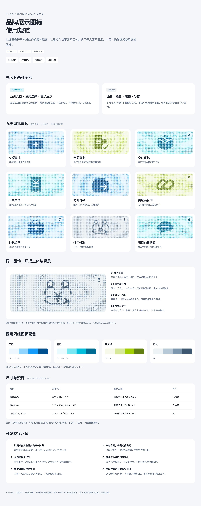

# fansai-data_Skill

FansAI 数据中台页面系统 Skill —— 薄荷液态玻璃 clean-SaaS 风格、Apple 式数据可视化，覆盖一级/二级/三级页面、列表、表单弹窗、图表与数字布局的统一规范。线上基线 **V2.1 = V2 完整基线 + 全系统工作台与复合数据页增量**。

> [下载线上基线 V2.1 Skill 包](fansai-data-system_Skill_V2.1.skill) · [查看 V2.1 主规范](fansai-data-system_Skill_V2.1/SKILL.md) · [查看飞书知识库](https://ycnlw8azhiz2.feishu.cn/wiki/P9FWwJHEXi8zHMkIUfOcasnwnZc?fromScene=spaceOverview)

## Demo 归档

[查看全部 Demo 与在线预览 →](docs/demo-archive.md)

## 核心 System Components

- <kbd>UPDATE · V2</kbd> **数据诚实铁律** —— 不编字段、行或数值；缺失留 `—`；示例值必须标记；不给真人配未经核实的图片；不擅自新增模块或二级页面
- <kbd>UPDATE · V2</kbd> **图表先选型再绘制** —— 单值评分用表现分环，占比构成默认用分段条，流程数据用流程图，排名坚持领先高亮、其余中性
- <kbd>UPDATE · V2</kbd> **列表页系统化** —— 表格 / 卡片 / 主从双栏三类页型；三段式操作列、组织首标、确定性人名头像、日期适用边界与长文本截断
- <kbd>UPDATE · V2</kbd> **布局与交互底线** —— 单层弥散背景，并排面板等高且底边对齐；筛选、排序、展开、联动真实可用；本地原型操作必须明确说明仅本地生效
- <kbd>NEW · V2.1</kbd> **全系统工作台与复合数据页** —— 主从实体层级、默认/审计双视图、局部时间轴、固定操作列、分组菜单与统一弹窗家族；客户资料是完整范例
- <kbd>NEW · V3</kbd> **品牌展示图标** —— 九类静态融合像素图用于大面积业务入口；导航、按钮等小图标继续用 IconPark
- <kbd>UPDATE · V3</kbd> **审批表面与组件** —— 弹窗浅灰蓝绿底、纯白前景；面性下拉与标签、紧凑目录、轻分隔与柔和行面
- <kbd>UPDATE · V3</kbd> **审批操作分层** —— 转交确认紧邻同事选择，与底部审批操作分层，当前步骤只有一个强主操作
- <kbd>UPDATE · V3</kbd> **评论与附件** —— 评论阅读层级清晰，输入区固定；回复、删除与附件预览保持上下文
- **设计令牌与排版** —— 墨色 `#1b2430`、teal `#008aa8`、蓝 `#49B6D8`；页面左右边距 36px；中文以 Noto Sans SC 500 为基准，数字与英文用 Outfit
- **数字与表单** —— 数字前缀 / 数值 / 单位基线对齐；自定义瓦片下拉替代原生 `select`；标签 chips、多指标状态锁定与必填校验
- **图标与头像** —— IconPark 内联 SVG；头像圆形并按 `hash(id) % N` 确定性分配，上传后覆盖
- **交付链路** —— HTML 高保真 → cairosvg 自检 → Figma 导入版 SVG；真实数据不清洗，示意数据明确标记

## 版本演进 V1.0 → V3

| 版本 | 新增 |
|---|---|
| **V1.0** | 基础规范定型：36px 页面边距、Noto Sans SC 500、面包屑式 header |
| **V1.1** | 新增表单与弹窗：玻璃模态、瓦片下拉、标签 chips、指标锁定与校验 |
| **V1.2** | 新增 IconPark 内联 SVG 图标规范 |
| **V1.3** | 新增默认头像库、`hash(id) % N` 确定性分配与上传覆盖 |
| **V2** | 完整继承 V1.3，再新增数据诚实、图表选型决策、列表页系统、单层背景、等高面板、语义色注册表、交互底线与代码卫生 |
| **V2.1** | 完整继承 V2，新增全系统主从层级、双视图、局部时间轴、固定操作、菜单与统一弹窗家族；客户资料为首个完整业务映射 |
| **V3** | 继承 V2.1，新增品牌展示图标、面性组件与审批交互优化 |

## Skill 明细（V2.1，线上基线）

V3：[下载完整 Skill 包](fansai-data-system_Skill_V3.skill) · [查看主规范](fansai-data-system_Skill_V3/SKILL.md)。

V2.1 在 V2 基线上收纳全系统工作台与复合数据页规则，并附客户资料完整交互范例，可独立安装，不依赖旧版本目录。

| 文件 | 说明 |
|---|---|
| [`SKILL.md`](fansai-data-system_Skill_V2.1/SKILL.md) | V2.1 主规范：完整 V2 基线 + 全系统工作台与复合数据页入口与铁律 |
| [`references/system-workbench-patterns.md`](fansai-data-system_Skill_V2.1/references/system-workbench-patterns.md) | 全系统主从层级、双视图、局部时间轴、固定操作、菜单、弹窗与场景选择规则 |
| [`references/customer_workbench_reference.html`](fansai-data-system_Skill_V2.1/references/customer_workbench_reference.html) | 客户资料完整交互范例：展示双视图、时间轴、菜单、下拉、日历和弹窗的实际组合 |
| [`references/`](fansai-data-system_Skill_V2.1/references/) | V2 数字、图表、列表、表单及 V1.3 完整基线参考 |
| [`assets/avatars/`](fansai-data-system_Skill_V2.1/assets/avatars/) | 默认头像库（5 个抽象渐变头像） |
| [`agents/openai.yaml`](fansai-data-system_Skill_V2.1/agents/openai.yaml) | V2.1 Skill 列表显示名称、简介与默认调用提示 |
| [`fansai-data-system_Skill_V2.1.skill`](fansai-data-system_Skill_V2.1.skill) | V2.1 自包含打包版，可直接下载导入 |

历史版本仍保留在 [`fansai-data-system_Skill_V1.3/`](fansai-data-system_Skill_V1.3/)。
